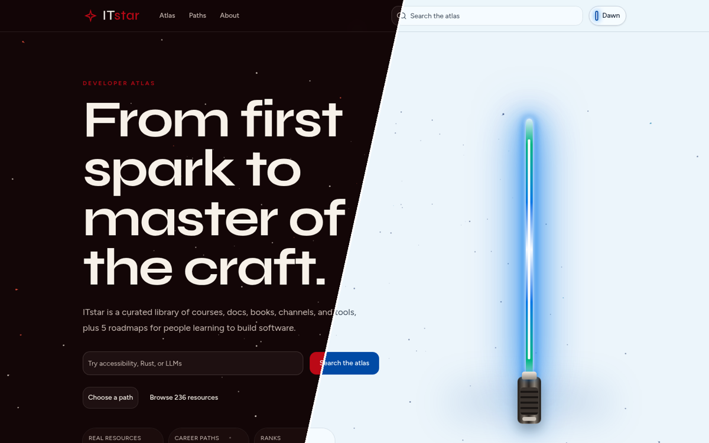
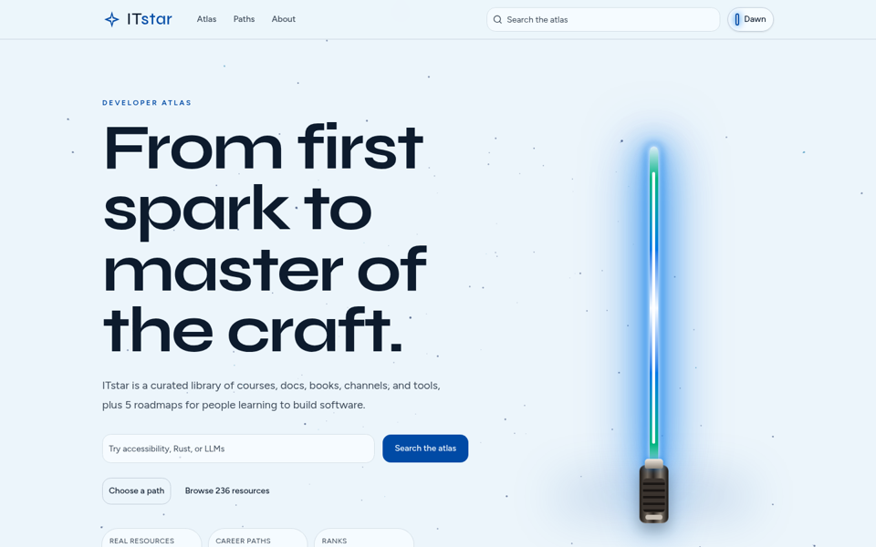
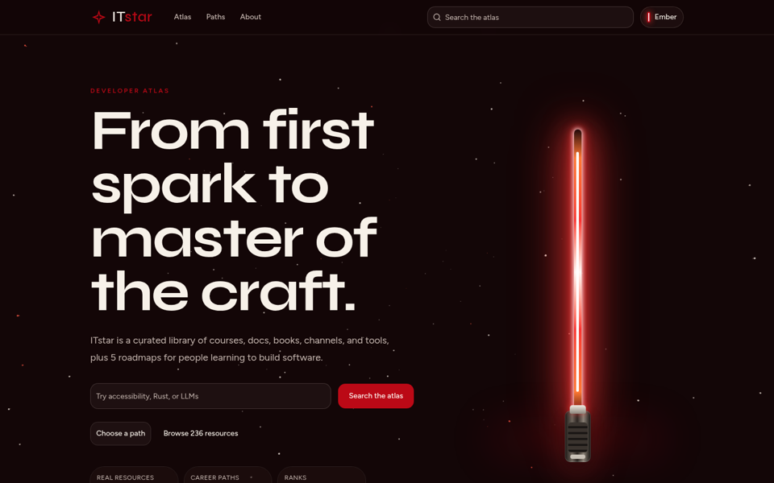
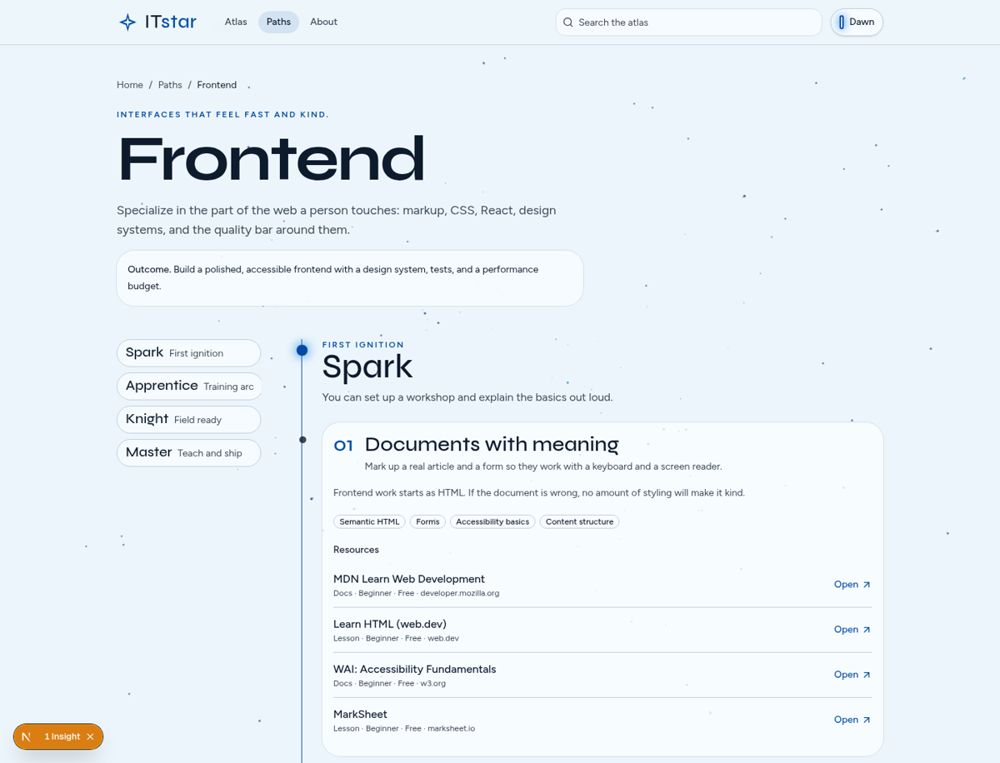

<div align="center">

# ✦ ITstar

### From first spark to master of the craft.

**A Star Wars-inspired atlas of free learning resources and career roadmaps for developers, and for everyone who wants to become one.**

[](https://itstar.vercel.app)
[](https://nextjs.org)
[](https://www.typescriptlang.org)
[](https://tailwindcss.com)

<br />

<a href="https://itstar.vercel.app"></a>

</div>

---

## 🌌 What is ITstar?

ITstar collects **236 hand-picked, real resources** (courses, lessons, articles, docs, YouTube channels, tools and books) and lays **five career roadmaps** over that library. No sign-up, no paywall, no fluff.

| 🤖 AI engineering | 🌐 Web development | 🎨 Frontend | ⚙️ Backend | 📱 Mobile apps |
|:---:|:---:|:---:|:---:|:---:|

Every path is a ranked journey through four stages:

> **✨ Spark** → **📘 Apprentice** → **⚔️ Knight** → **👑 Master**
>
> The ranks are a study pace, not a certificate. You move up when the milestone is true.

## ⚔️ Choose your side

The whole site has two moods, and you switch between them with a lightsaber.

<table>
  <tr>
    <td align="center"><b>🔵 Dawn</b> (light)</td>
    <td align="center"><b>🔴 Ember</b> (dark)</td>
  </tr>
  <tr>
    <td></td>
    <td></td>
  </tr>
</table>

- 🎇 Animated starfield background and a glowing energy blade
- 🔊 Toggling the theme plays a synthesized saber ignition (Web Audio API, no film assets)
- ♿ Respects `prefers-reduced-motion`, and sound only plays after you interact

## 🗺️ Roadmaps



Each stage links straight to the resources you need, in an order a human can actually follow.

## 🛠️ Tech stack

| Layer | Tools |
|---|---|
| Framework | Next.js (App Router), React 19, TypeScript |
| Styling | Tailwind CSS, shadcn/ui, Framer Motion |
| Content | Typed modules in `data/` (no database, no backend) |
| Hosting | Vercel |

`data/catalog.ts` is the boundary the pages use, so a CMS or database can replace it later without rewriting the screens.

## 🚀 Run locally

```bash
git clone https://github.com/msverlovych/it-star.git
cd it-star
npm install
npm run dev
```

Open [http://localhost:3000](http://localhost:3000). No environment variables needed.

```bash
npm run lint        # ESLint
npm run typecheck   # TypeScript
npm run build       # production build
```

## ➕ Add a resource

Edit `data/resources.ts`. Each entry needs a unique `slug`, a real `https` URL, a description, a type (`course`, `lesson`, `article`, `docs`, `channel`, `tool`, `book`), a level, a cost (`free`, `paid`, `freemium`), and tags.

To place it on a roadmap, add the slug to a stage in `data/paths.ts`. Importing the catalog throws if a slug is duplicated or a path points at a missing resource, so a broken link in the data fails the build.

## 🎨 Theme

Dawn is the light theme. Ember is the dark theme. The choice is stored under `itstar-theme`. On first visit the site follows the system preference until you toggle.

## 👨‍💻 Author

<div align="center">

Developed by **Maksym Sverlovych**, Senior Software Developer (React, JavaScript, Node.js, Java, iOS)

[](https://www.linkedin.com/in/maksym-sverlovych-b28821198/)
[](mailto:msverlovych@gmail.com)
[](https://github.com/msverlovych)

<sub>May the source be with you. ✦</sub>

</div>
